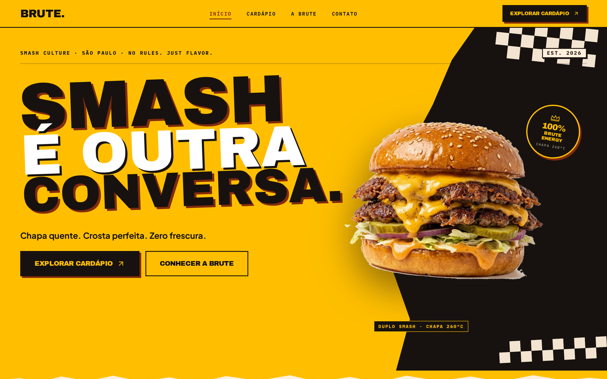
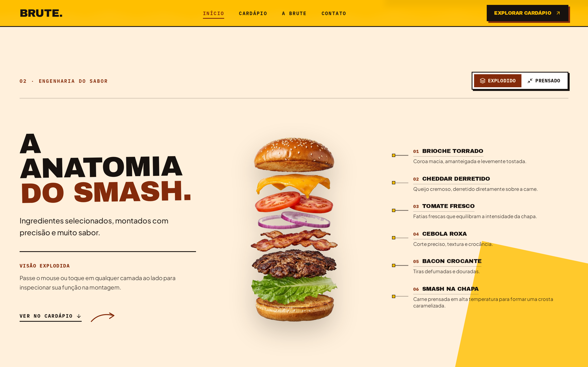
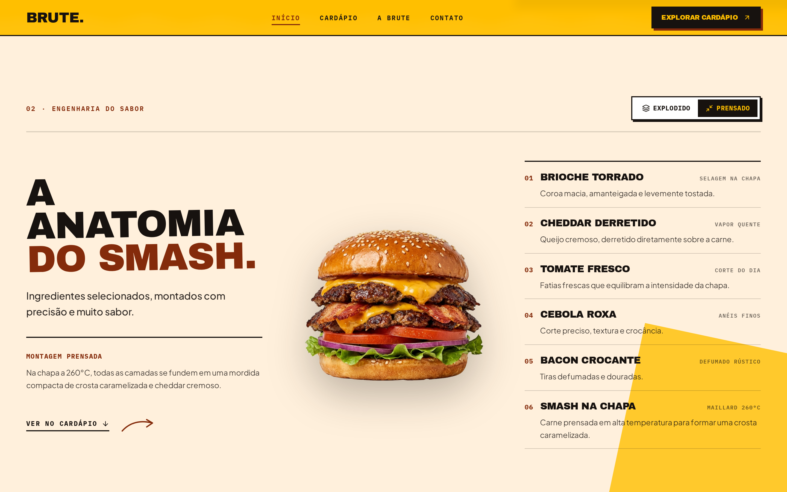
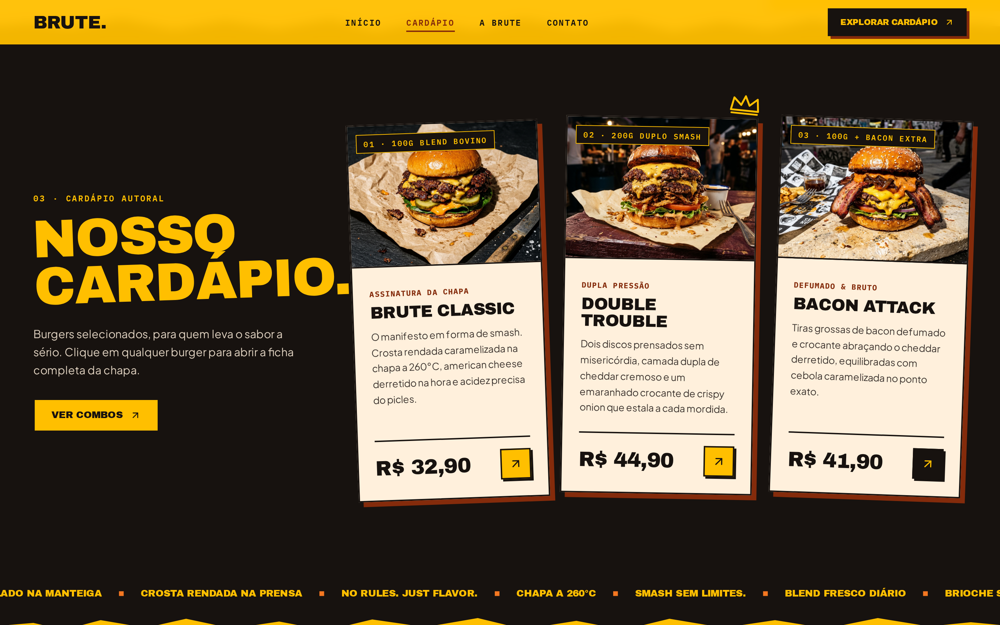
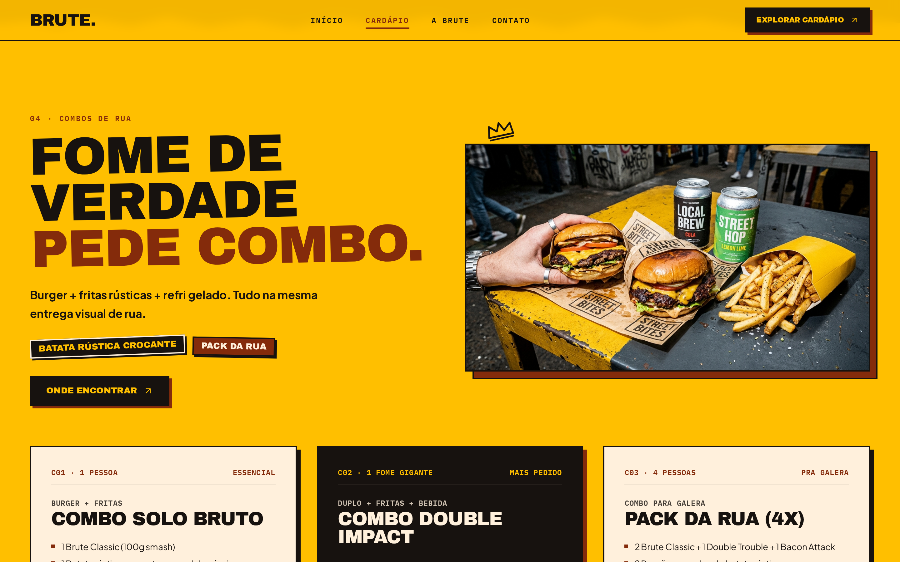
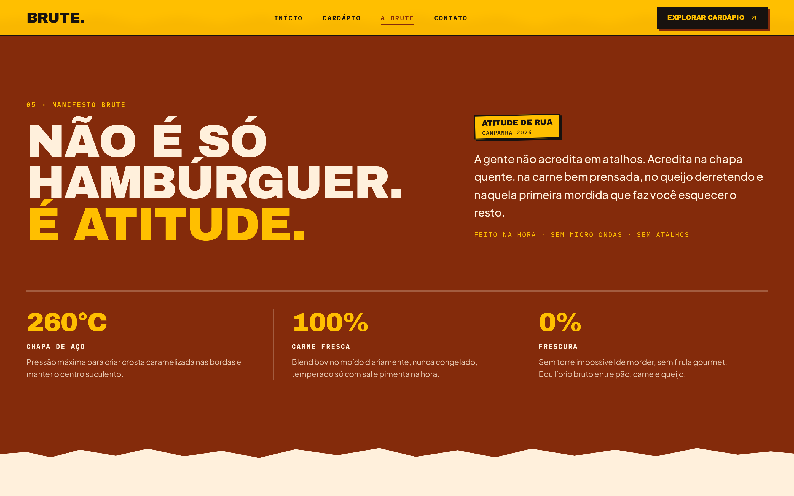
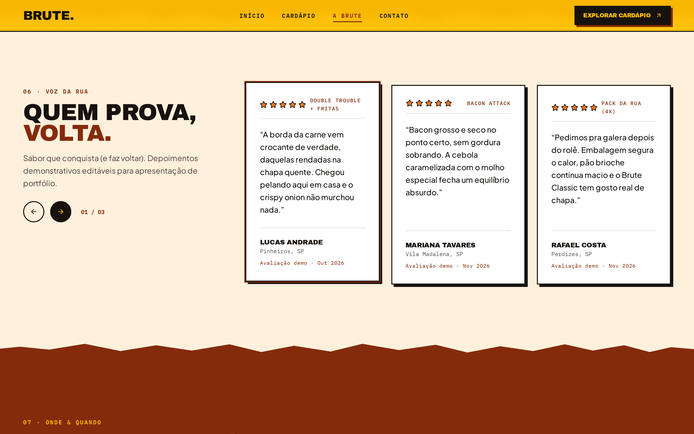
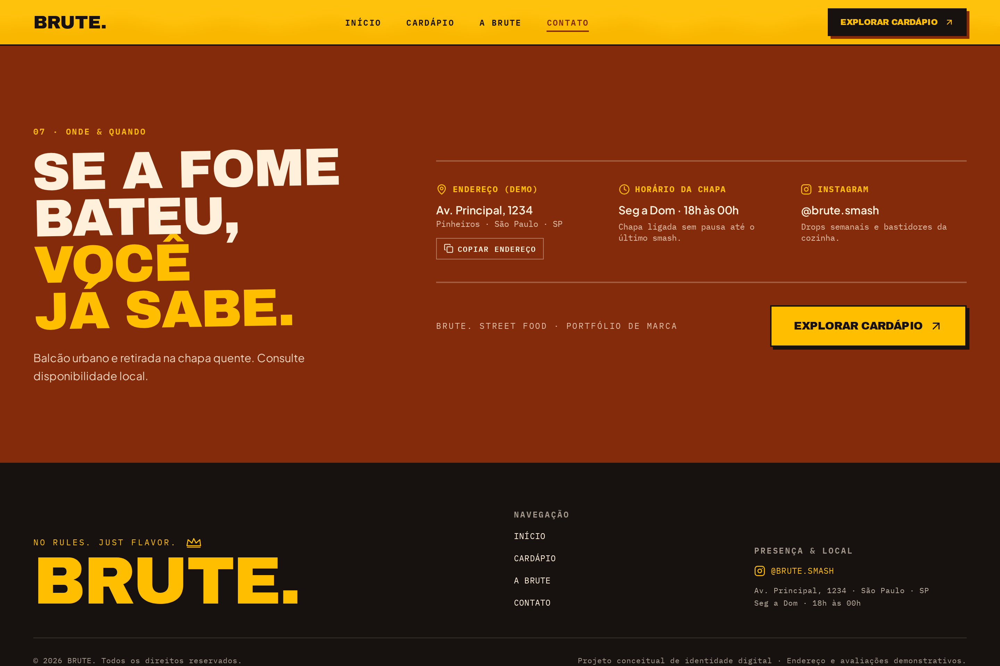
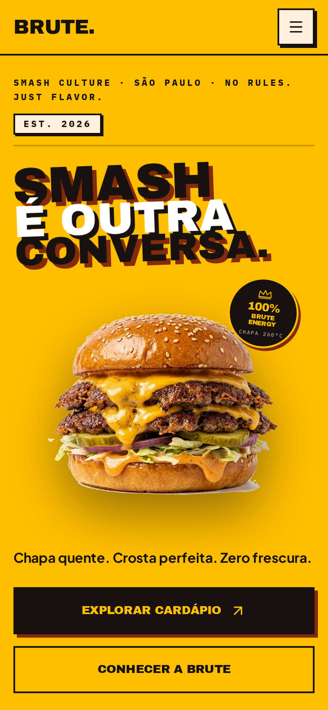
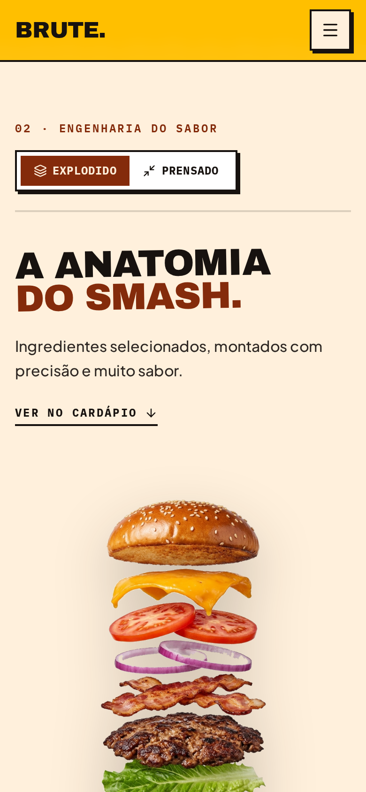

# BRUTE.

### NOT JUST ANOTHER BURGER JOINT.

*A bold digital experience built for a street food brand that refuses to blend in.*

**`DIGITAL CAMPAIGN`** · **`STREETWEAR ART DIRECTION`** · **`EDITORIAL MENU EXPERIENCE`**

 

---

## THE CONCEPT

Most restaurant websites follow the same predictable script: a soft hero photo, generic feature icons, and a flat grid of prices. **BRUTE.** was created to tear that template apart.

Conceived for an independent urban smash burger label with a Brazilian streetwear soul, **BRUTE.** treats street food like a cultural drop—loud, unapologetic, and impossible to ignore. Every screen behaves like a printed poster collided with a high-craft editorial spread:

- **Bold Visual Identity** — Built around raw contrast, torn graphic edges, checkered street patterns, and custom hand-drawn seals rather than sterile restaurant clichés.
- **Maximalist Typography** — Oversized condensed display headlines collide with crisp monospaced editorial labels to establish immediate hierarchy and attitude.
- **Experimental Editorial Compositions** — Asymmetric splits, angled poster cards, and overlapping cutout layers create movement and rhythm down the entire page.
- **Distinctive Food Photography** — Photorealistic smash burgers, sizzling crust details, and studio-lit ingredients sit directly on bold color fields without boxy frames.
- **Memorable Digital Presence** — Every interaction—from inspecting individual burger layers to browsing signature recipes—reinforces one unmistakable brand voice: *No rules. Just flavor.*

---

## THE EXPERIENCE

### 01 · The Hero — First-Second Impact

The opening screen ditches conventional restaurant framing for a full-bleed campaign poster. Tilted three-tier display typography overlaps a sharp dark-ink diagonal wedge, a studio-cutout double smash burger, checkered streetwear accents, and clear exploration anchors—putting appetite and personality front and center above the fold.

---

### 02 · Anatomy of a Smash — Interactive Flavor Engineering

Food craftsmanship becomes an interactive editorial centerpiece. Visitors can switch seamlessly between **Explodido** (an exploded vertical breakdown of toasted brioche, melted cheddar, fresh tomato, red onion, crisp bacon, seared smash patty, and lettuce) and **Prensado** (the finished 260°C pressed burger), hovering or tapping any layer to inspect its role in the build.

<table>
  <tr>
    <td width="50%" align="center">
      
       
      <strong>EXPLODIDO</strong> — Interactive layer-by-layer flavor breakdown
    </td>
    <td width="50%" align="center">
      
       
      <strong>PRENSADO</strong> — Complete 260°C pressed build inspection
    </td>
  </tr>
</table>

---

### 03 · Signature Menu — Poster-Style Discovery

Rather than hiding burgers inside a crowded spreadsheet list, the signature lineup (**Brute Classic**, **Double Trouble**, and **Bacon Attack**) is staged as slightly angled campaign cards on deep dark ink. Each card pairs tactile food photography with clear descriptions, pricing, and an expandable tasting spec sheet.

---

### 04 · Combos — Street Packs Built for Cravings

A dedicated high-contrast yellow section reframes meal deals as street packs (**Combo Solo Bruto**, **Combo Double Impact**, and **Pack da Rua 4x**), pairing lifestyle photography with sharp editorial specs and instant visual differentiation for the flagship combo.

---

### 05 · Brand Manifesto — Attitude Before Everything

Anchored in deep grill-inspired brown, the manifesto translates kitchen discipline into sharp brand storytelling—highlighting the three non-negotiable pillars of the house: a **260°C steel griddle**, **100% fresh daily beef**, and **0% pretension**.

---

### 06 · Social Proof & Closing Presence

Customer impressions sit on warm cream paper cards with interactive spotlight controls, flowing into a bold final invitation that brings together location details, grill hours, social presence, and a final return path to the menu.

<table>
  <tr>
    <td width="50%" align="center">
      
       
      <strong>VOZ DA RUA</strong> — Staggered editorial review cards
    </td>
    <td width="50%" align="center">
      
       
      <strong>ONDE &amp; QUANDO</strong> — Final brand presence &amp; footer
    </td>
  </tr>
</table>

---

## DESIGN DIRECTION

The visual system blends **urban streetwear branding** with **experimental print editorial design**. Instead of relying on heavy shadows or decorative clutter, hierarchy is driven by scale contrast, intentional negative space, crisp 2px ink borders, and disciplined color blocking across every section transition.

| Swatch | Role | Color Name | Hex |
| :---: | :--- | :--- | :--- |
| **■** | Primary Canvas &amp; High-Energy Highlights | Electric Yellow | `#FFBF00` |
| **■** | Editorial Paper Surfaces &amp; Light Contrast | Warm Cream | `#FFF0DC` |
| **■** | Storytelling Anchors &amp; Secondary Accents | Deep Brown | `#842B0B` |
| **■** | Headlines, Structural Borders &amp; Poster Ink | Dark Ink | `#17120F` |
| **■** | Interactive Pins &amp; Flavor Details | Flame Orange | `#F47721` |

- **Typographic Voice** — Heavy uppercase condensed display headlines paired with clean geometric body copy and technical monospaced micro-labels (`01`–`07` section indices, griddle specs, and stamps).
- **Purposeful Motion** — Subtle scroll-linked parallax, entrance reveals, and tactile hover states guide focus without slowing down exploration.

---

## THE VALUE

For an independent food brand competing in a saturated urban market, looking generic is the fastest way to be forgotten. **BRUTE.** turns a digital flagship into a commercial brand asset:

1. **Instant Brand Differentiation** — Separates the restaurant from template food sites within the first three seconds, positioning it as a recognizable cultural label.
2. **Heightened Product Desirability** — Studio cutout imagery and interactive ingredient storytelling make the food look tangible, crafted, and worth craving.
3. **Frictionless Menu Exploration** — Clear section pacing, bold price visibility, and scannable recipe cards help visitors understand the lineup effortlessly.
4. **Elevated Brand Perception** — Agency-grade art direction builds immediate credibility and premium perceived value while keeping a grounded, accessible street tone.
5. **Unforgettable First Impression** — Cohesive color storytelling and editorial rhythm ensure visitors remember the name long after closing the tab.

---

## RESPONSIVE EXPERIENCE

Every composition was adapted deliberately for handheld screens rather than simply shrunk down. Headlines scale proportionally without clipping, interactive controls maintain generous touch targets, the anatomy toggle switches into a clean vertical index, and photography stays sharp with zero horizontal overflow.

<table>
  <tr>
    <td width="60%" align="center" valign="top">
      
       
      <strong>Desktop Canvas</strong> — Overlapping asymmetric poster spread
    </td>
    <td width="20%" align="center" valign="top">
      
       
      <strong>Mobile Hero</strong>
    </td>
    <td width="20%" align="center" valign="top">
      
       
      <strong>Mobile Anatomy</strong>
    </td>
  </tr>
</table>

---

### BUILT TO STAND OUT. MADE TO BE CRAVED.

**BRUTE. — Street Food Digital Experience**

*No rules. Just flavor.*

